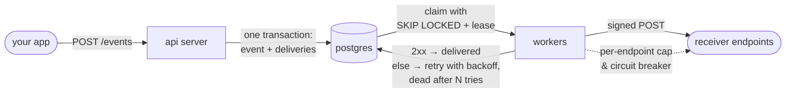

# webhook-delivery

[](https://github.com/gnanreddy13/webhook-delivery/actions/workflows/ci.yml)

a webhook delivery service i built in go & postgresql. register an endpoint, send events, and it delivers each one to every endpoint that wants it: signed, retried with exponential backoff, and given up on after enough tries.

postgres is the only infrastructure. the queue is just the `deliveries` table, and workers claim rows with `FOR UPDATE SKIP LOCKED`.



> ## security notice...
>
> this is a **single-tenant** service: one shared api key, one organization's endpoints. it's built to run as a service other systems call, as long as:
>
> - **it's served over tls.** set `TLS_CERT_FILE` and `TLS_KEY_FILE`, or put it behind a tls-terminating reverse proxy and set `ALLOW_INSECURE_HTTP=true`. otherwise the server refuses plain http on a non-loopback address.
> - **`ALLOW_PRIVATE_DESTINATIONS` stays off** (the default). with it off, ssrf protection blocks webhooks to loopback, private, link-local (incl. cloud metadata), cgnat and other reserved addresses. the check runs on the actual ip being connected to, so dns rebinding can't get around it. only the local demo and bench turn it on.
> - **the secrets in `.env` stay secret.** anyone with `API_KEY` can register endpoints and read delivery data. `SECRET_ENCRYPTION_KEY` decrypts the endpoint signing secrets. lose it and those secrets are gone.
>
> not included: per-client api keys or scopes, multi-tenancy, api rate limiting. see [limitations](#limitations).

## quick start...

you need go 1.25+ (tested on 1.25.0 through 1.27.2, see [platforms tested](docs/benchmarks.md#platforms-tested)), docker with compose v2, and `curl`. from a fresh clone:

```bash
./scripts/init-env.sh
docker compose up -d --wait
./scripts/demo.sh
```

`init-env.sh` writes `.env` (mode 600) with a random `API_KEY`, `SECRET_ENCRYPTION_KEY` and postgres password. it never overwrites an existing `.env`.

the demo only runs against a local database, and it **wipes the `endpoints`, `events` and `deliveries` tables**. then it:

1. builds and starts the server and a fake receiver. the receiver fails 30% of requests and checks signatures.
2. registers two endpoints: `/hook` (flaky) and `/fail` (always returns 500).
3. sends 200 events, then re-sends 50 of them as duplicates.
4. waits for the queue to drain and prints the results.

what you should see: every `/hook` delivery ends `delivered` after about 1.43 attempts on average, every `/fail` delivery ends `dead` after 6 attempts, no duplicate delivery rows, no bad signatures. the receiver lives on localhost, so the demo turns on `ALLOW_PRIVATE_DESTINATIONS`. it also turns off the circuit breaker and shortens backoff, so dead deliveries show up within seconds.

## deploying...

the server is one binary (or container) plus postgres. several replicas can share one database, since workers in different processes coordinate through row locks. i tested two processes, see [other verified behaviour](docs/benchmarks.md#other-verified-behaviour).

```bash
# Container image: static binary on distroless, runs as non-root (about 21 MB)
docker build -t webhook-delivery .

# Or run server and Postgres together locally (port published on 127.0.0.1 only)
docker compose --profile app up -d --build
```

checklist:

- **tls:** see the security notice above.
- **database:** for a database on another host, use `sslmode=verify-full` in `DATABASE_URL`. backups and ha are on you. migrations run automatically at startup under a postgres advisory lock.
- **health checks:** `GET /healthz` (process up) and `GET /readyz` (database reachable) need no api key.
- **metrics:** `GET /metrics`, prometheus text format, needs the api key as a bearer token.
- **key rotation:** to rotate `SECRET_ENCRYPTION_KEY`, move the old key to `SECRET_ENCRYPTION_KEY_PREVIOUS`, set a new one and restart. secrets get re-encrypted at startup, then the previous key can go. rotating `API_KEY` needs a restart and has no overlap period.
- **shutdown:** SIGTERM stops intake. each worker finishes its current attempt (bounded by `DELIVERY_TIMEOUT`), and claimed rows that weren't sent yet are released.

## api...

every route except the health checks needs `Authorization: Bearer $API_KEY`. you register endpoints, send events, and inspect or retry deliveries. receivers get json POSTs signed with `Webhook-Signature` and should dedupe on `Webhook-Id`. routes, examples, and how to verify a signature: [docs/api.md](docs/api.md).

## how it works...

- **transactional outbox.** an event and its deliveries are written in one transaction, so a 202 means every delivery row exists.
- **idempotent ingest.** sending the same event id twice is a no-op (`ON CONFLICT DO NOTHING`), even under concurrency.
- **leases, not long-held locks.** workers claim rows with `SKIP LOCKED` and a short lease. a crashed worker's rows come back when the lease expires, and the lease doubles as a fencing token.
- **per-endpoint isolation.** an exact in-flight cap per endpoint, fair claiming across endpoints, and a circuit breaker, so one slow or broken endpoint can't stall the rest.
- **ssrf protection.** every outbound connection's resolved ip is checked inside the dialer.
- **secrets at rest.** endpoint signing secrets are encrypted with AES-256-GCM.
- **at-least-once & unordered.** receivers should dedupe on `Webhook-Id`.

the full version, incl. the step-by-step flow and why the cap needed a two-statement sql function: [docs/design.md](docs/design.md).

## why postgres & not kafka...

- **one system, one transaction.** the outbox guarantee depends on the event and its delivery rows committing together. with kafka you'd need an outbox table plus a relay anyway, or a dual write that can lose or duplicate messages.
- **per-message state is the whole problem.** webhooks need per-delivery retry schedules, per-endpoint pausing and concurrency limits, dead letters, and questions like "show me the dead deliveries for endpoint x". in postgres those are rows, indexes and `UPDATE`s. kafka is an append-only log with per-partition offsets: delayed per-message retries need extra retry topics or a scheduler, and querying status means building a separate store.
- **enough throughput for a single tenant.** on a laptop: about 3,200 deliveries/s across 16 endpoints with an instant receiver, and about 2,260/s with 128 workers against a 50 ms receiver (see [numbers](#numbers)).
- **simpler to run.** one database to operate, back up and poke at with sql.

kafka (or similar) starts paying off at much higher volume, or when lots of independent consumers need the same event stream. see the roadmap.

## numbers...

| what | result |
|---|---|
| total throughput, 16 endpoints, 32 workers, instant receiver | 3,230 deliveries/s (median of 3 runs) |
| a single endpoint (per-endpoint ceiling) | about 1,000–1,300 deliveries/s |
| receiver taking 50 ms per request, 128 workers | 2,261 deliveries/s (88% of the ideal) |
| receiver failing 30% of requests | 99.98–100% delivered, about 1.43 attempts on average |
| POST /events p95 | 5.5–9.8 ms |

all measured on my macbook over localhost, so read them as a ceiling, not a capacity plan. conditions, every table, and other verified behaviour (crash recovery, two processes on one database, a database outage): [docs/benchmarks.md](docs/benchmarks.md).

## docs...

- [docs/api.md](docs/api.md): every route, curl examples, what a receiver gets, verifying signatures
- [docs/configuration.md](docs/configuration.md): every setting and its default (`.env.example` documents them too)
- [docs/design.md](docs/design.md): how it works, in detail
- [docs/benchmarks.md](docs/benchmarks.md): numbers, conditions, verified behaviour, platforms tested
- [docs/testing.md](docs/testing.md): running the server, the tests and the benchmarks, plus what each test checks

## limitations...

- **single tenant, single api key:** no per-client keys, scopes or api rate limiting.
- **per-endpoint throughput:** one endpoint tops out around 1,000–1,300 deliveries/s on my machine, because its claims are serialized (see [docs/design.md](docs/design.md)).
- **endpoint count:** claiming looks at every eligible endpoint, and the benchmarks used at most 16. very large endpoint counts (tens of thousands) are untested.
- **delivery guarantees:** at-least-once and unordered.
- **attempt history:** only the latest attempt's `last_status_code` and `last_error` are kept.
- **circuit breaker:** keeps probing a dead endpoint every `BREAKER_MAX_COOLDOWN`, forever. there's no automatic disable, so disable it through the api.
- **secret rotation:** no overlap window. the old secret stops being used immediately.
- **encryption key:** `SECRET_ENCRYPTION_KEY` is read from the environment (no kms integration).

## roadmap...

- **multi-tenancy:** accounts, per-tenant api keys with scopes, and tenant-scoped endpoints and deliveries.
- **rate limits:** per-key ingest limits, and per-endpoint request-rate limits on top of the concurrency cap.
- **smarter endpoint health:** honor `Retry-After` on 429 and 503, auto-disable after a long failure streak, and notify the owner.
- **per-attempt history:** a `delivery_attempts` table with status, latency, error, and a truncated response body.
- **bulk replay:** by endpoint and time range, on top of the single-delivery retry.
- **secrets:** kms-backed key management, and dual-secret signing during rotation.
- **kafka at scale:** keep the postgres outbox as the source of truth, and relay it into kafka (or similar) once volume or the number of consumers outgrows one database.

## license

mit, see [LICENSE](LICENSE).
